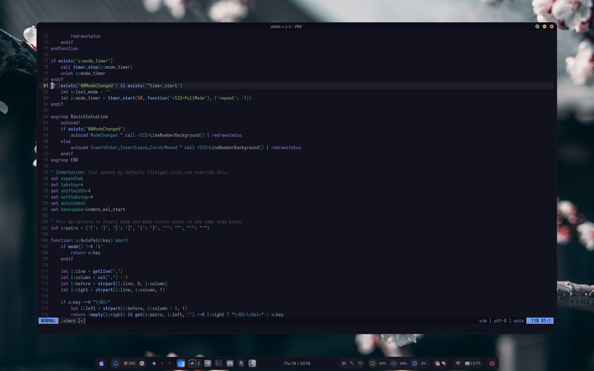

# share

Personal Vim without plugins and tcsh configuration.

## Vim



The C, C++, Python, Makefile, Tcl, Verilog, and SystemVerilog highlights use Vim
syntax rules with token roles drawn from the
[Tree-sitter highlight queries](https://github.com/nvim-treesitter/nvim-treesitter/tree/main/runtime/queries).
The configs also include custom tcsh highlighting.

In Insert mode, Vim pairs parentheses, brackets, braces, and quotes. Type a
matching closer to move past it, or press Backspace inside an empty pair to
remove both characters.

The completion menu opens after a short pause in Insert mode. The first
suggestion is selected while your typed text stays in place. Use `Tab` and
`Shift-Tab` to move, `Enter` to accept, and `Ctrl-E` to cancel. Vim 8 uses
timer-based keyword completion. Builds with native automatic completion limit
the menu to eight suggestions.

| Vim version | Config                                         | Compatibility                                                                             |
| ----------- | ---------------------------------------------- | ----------------------------------------------------------------------------------------- |
| 8.0 and 8.1 | [`vim/vimrc-8.0.vim`](vim/vimrc-8.0.vim)       | Uses timer-based mode updates when timers are available.                                  |
| 8.2         | [`vim/vimrc-8.2.vim`](vim/vimrc-8.2.vim)       | Uses `ModeChanged` when available and falls back to timer-based updates on early patches. |
| 9.x         | [`vim/vimrc-latest.vim`](vim/vimrc-latest.vim) | Uses `ModeChanged` and defaults `.v` files to Verilog.                                    |

The latest config targets [Vim 9.2](https://www.vim.org/vim-9.2-released.php).

### Try it

From the project root, run each config with the matching Vim binary. If your
older binaries use different names, substitute their paths.

```sh
vim80 -u "$PWD/vim/vimrc-8.0.vim"
vim82 -u "$PWD/vim/vimrc-8.2.vim"
vim   -u "$PWD/vim/vimrc-latest.vim"
```

### Use it by default

If you already have a `~/.vimrc`, back it up first. Then copy the config for
your Vim version to `~/.vimrc`. For the latest Vim, run the following command.

```sh
cp "$PWD/vim/vimrc-latest.vim" "$HOME/.vimrc"
```

## tcsh

The [two-line prompt](tcsh-prompt/prompt.csh) uses the same TokyoDark palette.
From the project root in tcsh, run `source tcsh-prompt/prompt.csh`.
